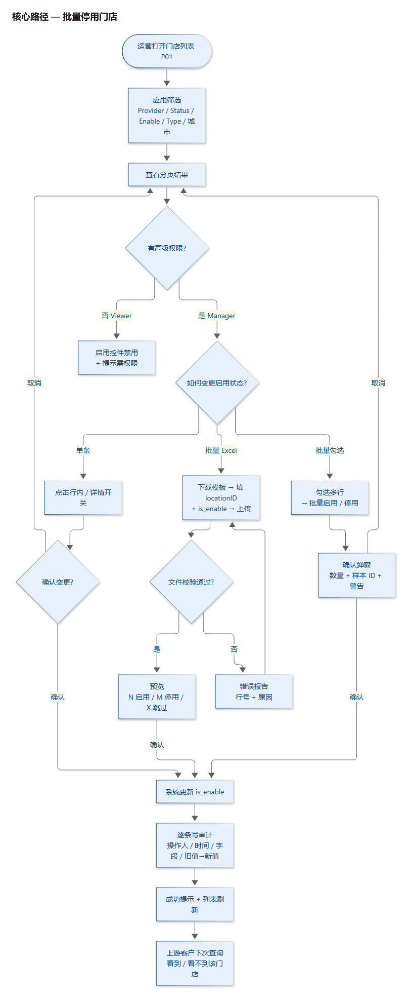
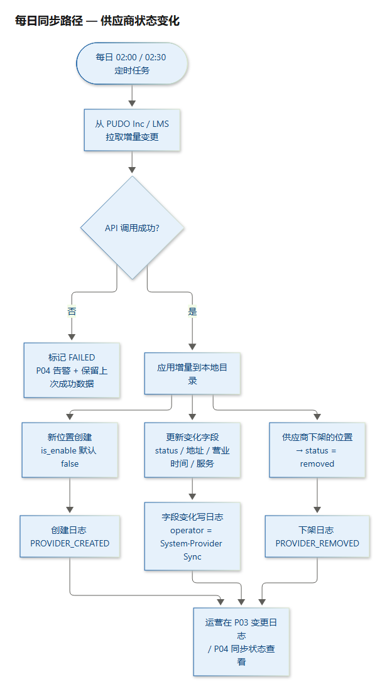
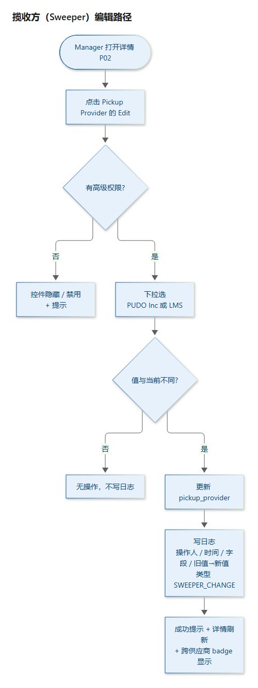
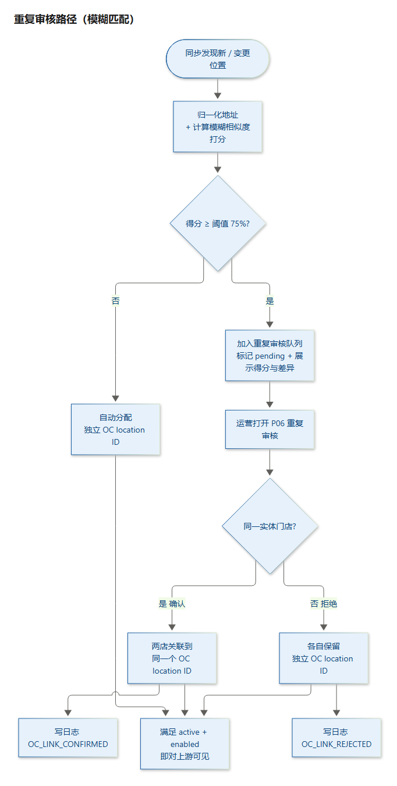
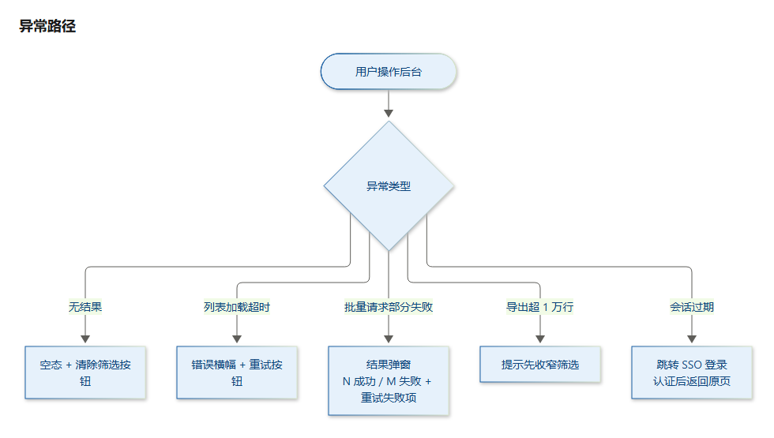

# Location Management Admin Console — 需求总览（字段解释 · 需求总结 · 流程图）

> **在线原型（公开可访问）**：https://jama-dev520.github.io/location-prototype/
> 配套文档：`Location-Management-Admin-PRD-2026-10-29`（正文 PRD，v1.1）
> 本文目的：一份速览文档，回答三个问题——①每个字段是什么意思；②这个需求到底做了什么、优先级如何；③核心流程长什么样。

---

## 一、字段解释（数据字典）

### 1.1 Location 门店统一模型（`location` 表）

> 数据来源：PUDO Inc + LMS 每日同步；`location_type` 供应商独占、`is_enable`/`pickup_provider`/`oc_location_id` 归 OC。

| 字段 | 类型 | 来源/归属 | 只读 | 解释 |
|---|---|---|---|---|
| `location_id` | varchar(32) PK | 系统内部 | 是 | 内部唯一 ID，永久稳定，不随供应商数据变化 |
| `oc_location_id` | varchar | OC | 是 | OC 自有的位置标识，用于把「同一实体门店」的多个供应商记录关联到一起；**没有它的位置永不上游同步** |
| `source_provider` | enum(PUDO/LMS) | 同步 | 是 | 来源供应商：PUDO Inc 或 LMS |
| `provider_ref` | varchar | 同步 | 是 | 供应商侧编号：dealerNo（PUDO）/ loc_id（LMS） |
| `store_code` | varchar | 同步 | 是 | 门店编码 |
| `name` | varchar | 同步 | 是 | 门店名称 |
| `location_type` | enum(PUDOpoint/Locker/packagehub) | 同步 | 是 | 门店类型，**与供应商互斥**：PUDO Inc → PUDOpoint/Locker；LMS → packagehub |
| `pickup_provider` | enum(PUDO/LMS) | OC（可编辑） | 否 | **揽收方（Sweeper）**——谁实际做上门揽收；默认 = `source_provider`，但可跨供应商（如 PUDO 店铺由 LMS 揽收） |
| `address_line1` / `address_line2` | varchar | 同步 | 是 | 地址行 1 / 行 2（行 2 可空） |
| `city` / `state` / `postal_code` / `country` | varchar | 同步 | 是 | 城市 / 州省 / 邮编 / 国家 |
| `latitude` / `longitude` | decimal | 同步 | 是 | 经纬度 |
| `phone` | varchar | 同步 | 是 | 电话（可空） |
| `timezone` | varchar | 同步 | 是 | 时区 |
| `status` | enum(active/inactive/removed) | 同步 | 是 | **供应商业务状态**：active 营业 / inactive 临时闭店 / removed 永久下架 |
| `is_enable` | bool | OC | 否 | **OC 内部开关**；仅 F06/F07 可写；新位置默认 `false` |
| `services[]` | array | 同步 | 是 | 服务列表：FX/CP/TB（PUDO）、returns/platform_dropoff/retail（LMS） |
| `restrictions[]` | array | 同步 | 是 | 限制列表（如 hazmat、overweight 等） |
| `hours_of_operation{}` | json | 同步 | 是 | 营业时间（7 天） |
| `cutoff_time` | time | 同步 | 是 | 截单时间（LMS，当日最晚投递时间） |
| `holiday_closures[]` | array | 同步 | 是 | 节假日停业 |
| `created_at` / `updated_at` | timestamp | 同步 | 是 | 创建 / 更新时间（**秒级精度**） |
| `activated_at` / `deactivated_at` | timestamp | 同步 | 是 | 激活 / 停用时间 |
| `last_synced_at` | timestamp | 系统 | 是 | 上次同步成功时间 |

### 1.2 变更日志（`change_log` 表）

> Append-only，不可变、不可删除。

| 字段 | 类型 | 解释 |
|---|---|---|
| `log_id` | bigint PK | 日志主键 |
| `location_id` | varchar FK | 关联门店 |
| `occurred_at` | timestamp | 变更发生时间 |
| `operator` | varchar | 操作人，或 `System · PUDO Sync` / `System · LMS Sync` |
| `operation_type` | enum | 见下表「审计日志类型」 |
| `field_name` | varchar | 变更的字段名 |
| `old_value` / `new_value` | text | 旧值 → 新值 |
| `source` | enum(MANUAL/SYNC) | 来源：人工 / 同步 |
| `remark` | text | 备注 |

### 1.3 重复判定对（`duplicate_pair` 表）

| 字段 | 类型 | 解释 |
|---|---|---|
| `pair_id` | varchar PK | 重复对 ID |
| `location_a` / `location_b` | varchar FK | 两个跨供应商的位置 |
| `matched_on` | text | 匹配维度：address_line1 + city + state + postal_code |
| `match_score` | int | **模糊相似度打分 0–100%**（权重：address_line1 50% + postal 25% + city 15% + state 10%） |
| `diff` | json | 逐字段差异（A 值 vs B 值） |
| `status` | enum(pending/confirmed/rejected) | 待确认 / 已确认同店 / 已拒绝不同店 |
| `detected_at` / `resolved_by` / `resolved_at` | — | 检出时间 / 处理人 / 处理时间 |

### 1.4 同步运行（`sync_run` 表）与用户（`user` 表）

| 表 | 字段 | 解释 |
|---|---|---|
| `sync_run` | `run_id`/`provider`/`started_at`/`finished_at`/`result`/`records_pulled`/`created_count`/`updated_count`/`deactivated_count`/`error_message` | 每个供应商每天一条同步记录 |
| `user` | `user_id`/`name`/`email`/`has_enable_permission` | 企业 SSO 用户；`has_enable_permission` 决定是否可启用/停用 |

### 1.5 审计日志类型（`operation_type` 枚举）

| 类型 | 含义 |
|---|---|
| `ENABLE` / `DISABLE` | 单条启用 / 停用（OC 操作） |
| `BATCH_ENABLE` / `BATCH_DISABLE` | 批量启用 / 停用（OC 操作） |
| `SWEEPER_CHANGE` | 揽收方（pickup_provider）变更 |
| `OC_LINK_CONFIRMED` / `OC_LINK_REJECTED` | 重复判定：确认同店 / 确认不同店 |
| `PROVIDER_STATUS_CHANGE` | 供应商状态变化（同步产生） |
| `PROVIDER_FIELD_UPDATE` | 供应商字段更新（同步产生） |
| `PROVIDER_CREATED` / `PROVIDER_REMOVED` | 供应商新增 / 下架（同步产生） |

### 1.6 核心字段语义区分（易混淆点）

| 概念 | 含义 | 关键区别 |
|---|---|---|
| `status`（供应商） | 供应商来源的业务状态 | 供应商拥有，只读 |
| `is_enable`（OC） | OC 内部启用开关 | OC 拥有，可写 |
| `removed` vs `inactive` | removed = 永久下架（终止合作）；inactive = 临时闭店 | **两种不同语义，不能混** |
| `source_provider` vs `pickup_provider` | 前者=数据来源；后者=实际揽收方 | 可跨供应商（cross-provider sweep） |
| `location_id` vs `oc_location_id` | 前者=内部主键；后者=OC 跨供应商关联标识 | OC ID 门控上游同步 |

**可见性规则（核心）**：一个位置对上游客户可见，**当且仅当** 同时满足：
`有 oc_location_id` **AND** `status = active` **AND** `is_enable = true`。

---

## 二、需求总结 + 优先级

### 2.1 一句话概括

> 做一个内部后台，把 PUDO Inc 和 LMS 两个供应商的门店数据每日同步并合并成统一目录，让运营能**筛选、查看、导出**，并**精准控制哪些门店对上游客户可见**，全程留痕可审计。

### 2.2 优先级总表

> 优先级：**P0 = 必须做（MVP）**，**P1 = 重要**，**P2 = 可延后**。

| ID | 模块 | 功能 | 优先级 | 一句话说明 |
|---|---|---|---|---|
| F01 | 门店列表 | 分页列表 | **P0** | 展示两供应商合并的门店，含全部关键列 |
| F02 | 门店列表 | 筛选与搜索 | **P0** | 多条件 AND 组合：Location ID / OC ID / 名称 / 地址 / 城市 / 州 / Provider / Pickup / Status / Enable / Type / 时间范围 |
| F03 | 门店列表 | 导出 CSV | **P0** | 按当前筛选结果导出，最多 1 万行 |
| F04 | 门店详情 | 详情页（三 Tab） | **P0** | 基本信息 / 营业时间与服务 / 变更历史 |
| F05 | 变更历史 | 单店变更日志 | **P0** | 一条门店的完整变更时间线 |
| F06 | 启用控制 | 单条启用/停用 | **P0** | 需高级权限，写审计 |
| F07 | 启用控制 | 批量启用/停用 | **P0** | 两种方式：勾选批量 / Excel 上传 |
| F08 | 变更历史 | 全局变更日志 | P1 | 跨门店检索所有变更 |
| F09 | 数据同步 | 每日同步状态 | P1 | 每次同步的结果与失败告警 |
| F10 | 概览 | 仪表盘 KPI | P2 | 总数 / 可见 / 停用等指标卡 |
| F11 | 揽收控制 | 编辑揽收方（Sweeper） | **P0** | 后台可改 pickup_provider，写 SWEEPER_CHANGE 日志 |
| F12 | 重复检测 | 跨供应商模糊去重 | **P0** | 模糊匹配打分 ≥75% 标记疑似重复，运营确认同店/不同店 |

### 2.3 关键业务决策清单

| # | 决策 | 结论 |
|---|---|---|
| 1 | 数据同步方式 | 每日增量同步（PUDO 02:00 / LMS 02:30），失败保留上次成功快照 |
| 2 | 可见性门控 | 三重门控：有 OC ID + status=active + is_enable=true |
| 3 | `status` vs `is_enable` | 独立两个字段；status 供应商来源，is_enable OC 开关 |
| 4 | 新位置默认 | `is_enable = false`，需 Manager 显式启用 |
| 5 | Type ↔ Provider | 互斥：PUDO→PUDOpoint/Locker，LMS→packagehub |
| 6 | 揽收方 pickup_provider | 默认=source_provider，可跨供应商，OC 可编辑 |
| 7 | 删除 vs 停用 | removed（永久下架）与 inactive（临时闭店）分开 |
| 8 | 地址去重 | **模糊匹配**（相似度打分 ≥75%），非精确匹配 |
| 9 | OC location ID | 关联同一实体门店的跨供应商记录，门控上游同步 |
| 10 | 角色权限 | Viewer（查看/导出）与 Location Manager（+启用/停用/揽收编辑/去重确认） |

---

## 三、流程图

### 3.1 核心路径 — 批量停用门店

### 3.2 每日同步路径 — 供应商状态变化

### 3.3 揽收方（Sweeper）编辑路径

### 3.4 重复审核路径（模糊匹配）

### 3.5 异常路径

---

## 附：一页速览（30 秒看懂）

| 维度 | 内容 |
|---|---|
| **做什么** | 内部后台，合并管理 PUDO Inc + LMS 两个供应商的门店目录 |
| **给谁用** | Viewer（查看/导出）、Location Manager（+启用/停用/揽收/去重） |
| **数据怎么来** | 每日增量同步，失败保留上次成功快照 |
| **核心控制** | is_enable 开关 + OC location ID 门控，决定上游可见性 |
| **去重逻辑** | 跨供应商地址模糊匹配打分 ≥75% 即疑似重复，人工确认 |
| **审计** | 每一次可见性/字段/揽收/去重变化都留痕 |
| **交付页面** | P01 列表 / P02 详情 / P03 全局日志 / P04 同步状态 / P05 仪表盘 / P06 重复审核 |
